# Automated study report

Generated 2026-11-16 06:26 UTC from the current model outputs.
Connection target: **245 MW** (at or above the modelled training-profile peak demand).
All results are public-data screening values, not connection approvals.

## 1. Thevenin screening of connection points

Base load power factor follows the voltage-banded NER minimum; source voltage
1.00 pu; criterion 0.95 pu.
Thermal limits are applied only where a public headroom value exists. Thermal
headroom cannot be inferred from fault level: it needs line and transformer
ratings, existing flows and N-1 load-flow results from the network owner. The
3% voltage-step limit is an initial-screening assumption
(NER S5.1.5, S5.3.7) until Powerlink confirms the limit for this connection.

| ConnectionPoint | Case | FaultLevelMVA | BasePowerFactor | LastPassingMW | SCRAtTarget | PVNoseMW | FullTripVoltageStepPercent | BindingConstraint |
| --- | --- | --- | --- | --- | --- | --- | --- | --- |
| Bouldercombe 275 kV | intact | 4,810.77 | 0.98 | 623.00 | 19.64 | 1,819.56 | 1.72 | Voltage below 0.95 pu |
| Bouldercombe 275 kV | n_minus_1 | 4,096.30 | 0.98 | 530.00 | 16.72 | 1,549.33 | 2.06 | Voltage below 0.95 pu |
| Calliope River 275 kV | intact | 4,953.67 | 0.98 | 641.00 | 20.22 | 1,873.60 | 1.66 | Voltage below 0.95 pu |
| Calliope River 275 kV | n_minus_1 | 4,143.93 | 0.98 | 536.00 | 16.91 | 1,567.34 | 2.03 | Voltage below 0.95 pu |
| Larcom Creek 275 kV | intact | 4,382.09 | 0.98 | 567.00 | 17.89 | 1,657.42 | 1.91 | Voltage below 0.95 pu |
| Larcom Creek 275 kV | n_minus_1 | 1,571.84 | 0.98 | 203.00 | 6.42 | 594.51 | 6.77 | Voltage below 0.95 pu |
| Pegs Creek 22 kV | public_upper_bound | 262.93 | 0.90 | 18.00 | 1.07 | 77.67 | n/a | Published thermal headroom |
| Bulgarra 22 kV | public_upper_bound | 262.93 | 0.90 | 20.00 | 1.07 | 77.67 | n/a | Voltage below 0.95 pu |
| Wedgefield 22 kV | public_upper_bound | 274.36 | 0.90 | 18.00 | 1.12 | 81.05 | n/a | Published thermal headroom |

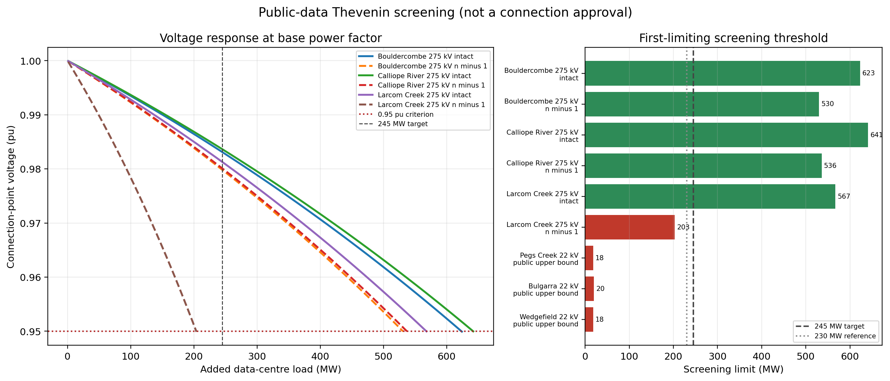

### Sensitivity to load PF and pre-connection source voltage (voltage-limited MW)

| ConnectionPoint | Case | PF 0.95 / 1.0 pu | PF 0.95 / 1.03 pu | PF 0.95 / 1.05 pu | PF 0.98 / 1.0 pu | PF 0.98 / 1.03 pu | PF 0.98 / 1.05 pu | PF 1.0 / 1.0 pu | PF 1.0 / 1.03 pu | PF 1.0 / 1.05 pu |
| --- | --- | --- | --- | --- | --- | --- | --- | --- | --- | --- |
| Bouldercombe 275 kV | intact | 480 | 732 | 890 | 623 | 924 | 1,107 | 1,059 | 1,437 | 1,500 |
| Bouldercombe 275 kV | n_minus_1 | 409 | 623 | 758 | 530 | 786 | 942 | 901 | 1,223 | 1,410 |
| Bulgarra 22 kV | public_upper_bound | 26 | 28 | 28 | 29 | 29 | 29 | 30 | 30 | 30 |
| Calliope River 275 kV | intact | 494 | 754 | 917 | 641 | 951 | 1,140 | 1,090 | 1,480 | 1,500 |
| Calliope River 275 kV | n_minus_1 | 414 | 631 | 767 | 536 | 795 | 954 | 912 | 1,238 | 1,427 |
| Larcom Creek 275 kV | intact | 437 | 667 | 811 | 567 | 841 | 1,008 | 964 | 1,309 | 1,500 |
| Larcom Creek 275 kV | n_minus_1 | 157 | 239 | 291 | 203 | 301 | 361 | 345 | 469 | 541 |
| Pegs Creek 22 kV | public_upper_bound | 19 | 19 | 19 | 19 | 19 | 19 | 20 | 20 | 20 |
| Wedgefield 22 kV | public_upper_bound | 19 | 19 | 19 | 19 | 19 | 19 | 20 | 20 | 20 |

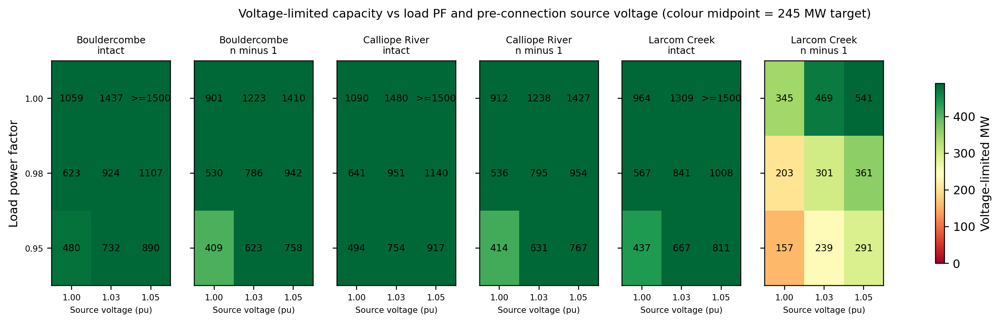

## 2. Karratha 132 kV reduced ring

| Scenario | PowerFactor | LastPassingAddedMW | SCRAtTarget | TripVoltageStepAtLimitPercent | BindingConstraint |
| --- | --- | --- | --- | --- | --- |
| intact | 0.96 | 74.00 | 5.62 | 2.88 | PCK voltage below 0.95 pu |
| n_minus_1_krt_pck | 0.96 | 53.00 | 4.94 | 2.42 | PCK voltage below 0.95 pu |
| n_minus_1_krt_bul | 0.96 | 66.00 | 5.36 | 2.73 | PCK voltage below 0.95 pu |
| n_minus_1_bul_pck | 0.96 | 66.00 | 5.36 | 2.73 | PCK voltage below 0.95 pu |

Firm N-1 at base assumptions: **53 MW**. Across the source-strength,
PF and source-voltage sweep: 0-93 MW.

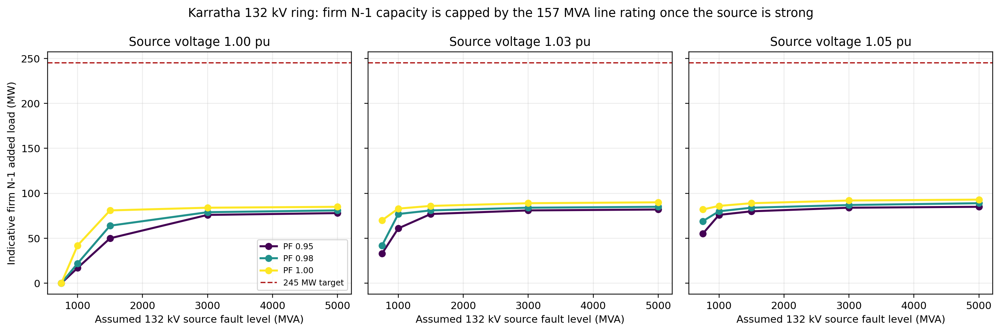

## 3. Pilbara uncertainty (1000 Latin-hypercube samples)

P05 / P50 / P95 firm N-1: **53 / 82 / 88 MW**.
92% of samples are limited by the 157 MVA line rating,
whose ceiling is 94 MW, so the upper percentiles are a rating cap rather than a
statistical finding. Most influential parameter: **SourceFaultMVA**
(swing 51 MW). Probability of reaching 245 MW: 0%.

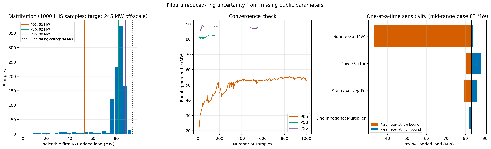

## 4. Rockhampton single-year PV/BESS (2024, 200 MW import limit)

| CaseLabel | PeakGridImportMW | HoursAboveImportLimit | BatteryPvChargingMWh | BatteryGridChargingMWh | CompliesWithImportLimit |
| --- | --- | --- | --- | --- | --- |
| Grid-only baseline | 239.91 | 4160 | 0.00 | 0.00 | False |
| 100 MW PV | 220.42 | 1219 | 0.00 | 0.00 | False |
| 200 MW PV | 219.35 | 1108 | 0.00 | 0.00 | False |
| 200 MW PV + 50 MW / 200 MWh BESS (solar charging only) | 219.35 | 1092 | 0.00 | 0.00 | False |
| 200 MW PV + 100 MW / 400 MWh BESS (solar charging only) | 219.35 | 1070 | 0.00 | 0.00 | False |
| 200 MW PV + 50 MW / 200 MWh BESS (grid charging allowed) | 200.00 | 0 | 0.00 | 5,193.05 | True |
| 200 MW PV + 100 MW / 400 MWh BESS (grid charging allowed) | 200.00 | 0 | 0.00 | 5,277.38 | True |

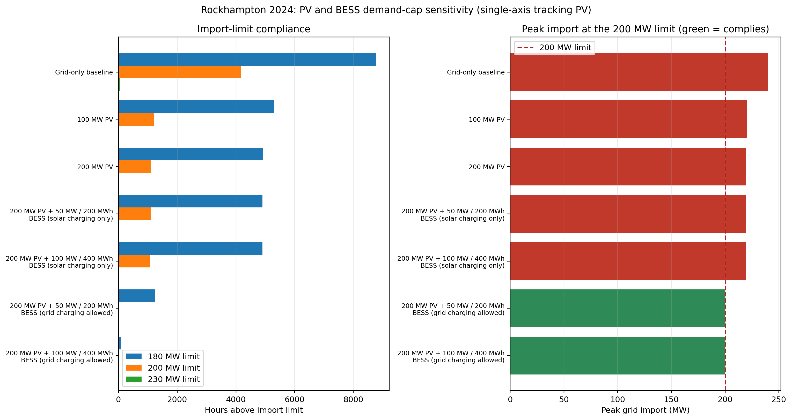
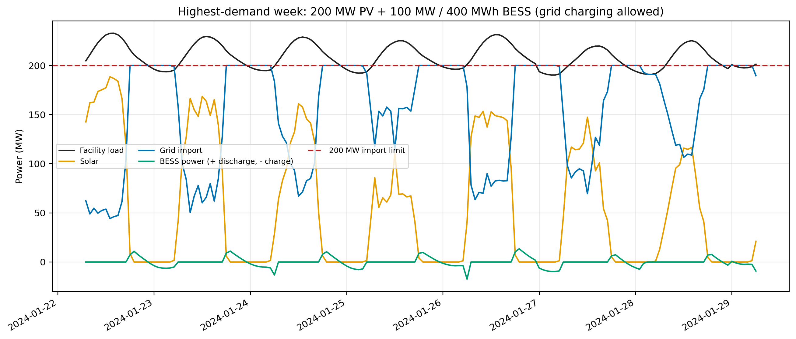

## 5. Rockhampton multi-year least-cost sizing (2020-2024)

| LoadProfile | ImportLimitMW | Selection | PvMW | BessPowerMW | BessEnergyMWh | NetworkChargesAUDm | TotalAnnualCostAUDm | AnnualScope2EmissionsKt | HourlyMatchedEmissionsKt | CfeScore | OnsiteRenewableFraction |
| --- | --- | --- | --- | --- | --- | --- | --- | --- | --- | --- | --- |
| inference | 180.00 | Least cost (any charging) | 100.00 | 0.00 | 0.00 | 10.79 | 123.96 | 470.65 | 484.12 | 0.39 | 0.24 |
| inference | 180.00 | Least cost (no grid charging) | 100.00 | 0.00 | 0.00 | 10.79 | 123.96 | 470.65 | 484.12 | 0.39 | 0.24 |
| inference | 200.00 | Least cost (any charging) | 100.00 | 0.00 | 0.00 | 10.79 | 123.96 | 470.65 | 484.12 | 0.39 | 0.24 |
| inference | 200.00 | Least cost (no grid charging) | 100.00 | 0.00 | 0.00 | 10.79 | 123.96 | 470.65 | 484.12 | 0.39 | 0.24 |
| inference | 230.00 | Least cost (any charging) | 100.00 | 0.00 | 0.00 | 10.79 | 123.96 | 470.65 | 484.12 | 0.39 | 0.24 |
| inference | 230.00 | Least cost (no grid charging) | 100.00 | 0.00 | 0.00 | 10.79 | 123.96 | 470.65 | 484.12 | 0.39 | 0.24 |
| mixed | 180.00 | Least cost (any charging) | 100.00 | 50.00 | 100.00 | 16.37 | 174.89 | 739.38 | 730.24 | 0.37 | 0.18 |
| mixed | 180.00 | Least cost (no grid charging) | 200.00 | 50.00 | 100.00 | 13.63 | 175.06 | 601.35 | 619.26 | 0.46 | 0.33 |
| mixed | 200.00 | Least cost (any charging) | 100.00 | 0.00 | 0.00 | 16.38 | 168.64 | 739.37 | 730.23 | 0.37 | 0.18 |
| mixed | 200.00 | Least cost (no grid charging) | 100.00 | 0.00 | 0.00 | 16.38 | 168.64 | 739.37 | 730.23 | 0.37 | 0.18 |
| mixed | 230.00 | Least cost (any charging) | 100.00 | 0.00 | 0.00 | 16.38 | 168.64 | 739.37 | 730.23 | 0.37 | 0.18 |
| mixed | 230.00 | Least cost (no grid charging) | 100.00 | 0.00 | 0.00 | 16.38 | 168.64 | 739.37 | 730.23 | 0.37 | 0.18 |
| training | 180.00 | Least cost (any charging) | 400.00 | 150.00 | 900.00 | 15.35 | 251.84 | 686.68 | 708.41 | 0.53 | 0.42 |
| training | 200.00 | Least cost (any charging) | 200.00 | 50.00 | 100.00 | 18.99 | 218.44 | 860.04 | 857.62 | 0.43 | 0.27 |
| training | 200.00 | Least cost (no grid charging) | 400.00 | 50.00 | 200.00 | 15.64 | 229.67 | 691.42 | 719.53 | 0.52 | 0.41 |
| training | 230.00 | Least cost (any charging) | 200.00 | 0.00 | 0.00 | 19.09 | 213.15 | 859.74 | 857.28 | 0.43 | 0.27 |
| training | 230.00 | Least cost (no grid charging) | 200.00 | 0.00 | 0.00 | 19.09 | 213.15 | 859.74 | 857.28 | 0.43 | 0.27 |

Costs are annualised CSIRO GenCost capital costs, grid energy at historical
hourly AEMO prices, and Powerlink 2026/27 transmission network charges
(locational demand charge on monthly peak import plus energy-based
non-locational and common-service charges; GST removed). PV is selected even
where the limit does not require it because its levelised cost is below the
average wholesale-plus-network price.

Emissions are reported two ways: **location-based scope 2** with the annual
NGA factor (the reporting convention), and **hourly-matched** emissions using
the Queensland grid's hour-by-hour intensity (01 Nov 2025 - 31 Oct 2026, AEMO SCADA x CDEII
factors). The **CFE score** is the share of facility energy met in the same
hour by carbon-free supply (on-site PV plus the grid's zero-emission share).
Queensland grid intensity ranges from 0.50 t/MWh at
9:00 to 0.73 t/MWh at
5:00 on average, so the timing of grid imports matters.

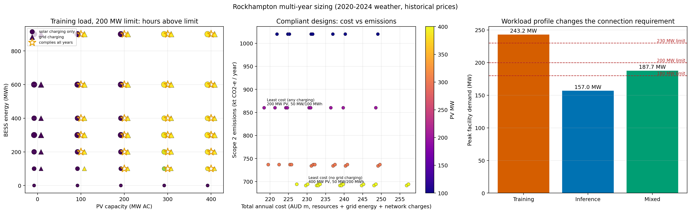

## 6. Northern Australia multi-site comparison

| Rank | Site | FeasibilityGate | FirmScreeningMW | PeakFacilityDemandMW | SCRAtTarget | SolarCapacityFactor | AnnualMeanPUE | AnnualWaterUseML | CostOfSupplyAUDperMWh | EmissionsIntensityTperMWh | Score_WeightedScore |
| --- | --- | --- | --- | --- | --- | --- | --- | --- | --- | --- | --- |
| 1 | Gladstone | Passes network screen | 536.000 | 239.246 | 16.914 | 0.270 | 1.167 | 1,928.182 | 113.537 | 0.489 | 0.633 |
| 2 | Rockhampton | Passes network screen | 530.000 | 243.151 | 16.720 | 0.272 | 1.172 | 2,029.994 | 113.316 | 0.489 | 0.610 |
| 3 | Livingstone (Yeppoon) | Passes network screen | 530.000 | 236.981 | 16.720 | 0.273 | 1.170 | 2,246.469 | 113.374 | 0.487 | 0.571 |
| 4 | Karratha | Fails network screen - augmentation required | 53.000 | 238.578 | 4.939 | 0.308 | 1.189 | 3,017.882 | 101.533 | 0.334 | 0.521 |
| 5 | Port Hedland | Fails network screen - augmentation required | 18.000 | 255.359 | 1.120 | 0.306 | 1.216 | 2,916.458 | 101.748 | 0.331 | 0.380 |

Criteria excluded for missing data: none. NWIS energy cost uses an
ASSUMED flat price. Score differences between nearby Queensland sites are
within the resolution of the NASA POWER grid and should not be over-interpreted.

| Site | RegionalDemandContext |
| --- | --- |
| Gladstone | 2.2% of QLD1 peak demand (10,893 MW) |
| Rockhampton | 2.2% of QLD1 peak demand (10,893 MW) |
| Livingstone (Yeppoon) | 2.2% of QLD1 peak demand (10,893 MW) |

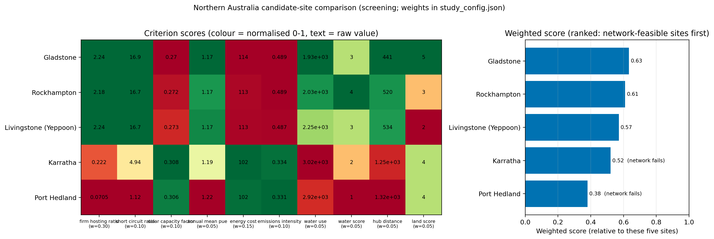

Training-only vs a 50/50 training/inference mix:

| Site | PeakFacilityDemandMW | MixedWorkloadPeakMW | LeastCostDesign | MixedWorkloadLeastCostDesign | CostOfSupplyAUDperMWh | MixedWorkloadCostOfSupplyAUDperMWh | CfeScore |
| --- | --- | --- | --- | --- | --- | --- | --- |
| Gladstone | 239.25 | 184.29 | 200 MW PV + 50 MW/100 MWh BESS (grid charging) | 100 MW PV + 0 MW/0 MWh | 113.54 | 113.56 | 0.43 |
| Rockhampton | 243.15 | 187.68 | 200 MW PV + 50 MW/100 MWh BESS (grid charging) | 100 MW PV + 0 MW/0 MWh | 113.32 | 113.46 | 0.43 |
| Livingstone (Yeppoon) | 236.98 | 185.90 | 200 MW PV + 50 MW/100 MWh BESS (grid charging) | 100 MW PV + 0 MW/0 MWh | 113.37 | 113.55 | 0.43 |
| Karratha | 238.58 | 191.29 | 300 MW PV + 50 MW/200 MWh BESS (grid charging) | 200 MW PV + 0 MW/0 MWh | 101.53 | 98.56 | n/a |
| Port Hedland | 255.36 | 199.72 | 300 MW PV + 50 MW/300 MWh BESS (grid charging) | 200 MW PV + 0 MW/0 MWh | 101.75 | 97.84 | n/a |

Water, land and connectivity evidence (scores 1-5 from cited public
sources; distance to the nearest data-centre hub as a latency proxy):

| Site | WaterScore | LandScore | HubDistanceKm | NearestHub | WaterBasis | LandBasis |
| --- | --- | --- | --- | --- | --- | --- |
| Gladstone | 3 | 5 | 441 | Brisbane | Awoonga Dam allocation (78 GL/yr) fully committed and ~43-46% full in 2025; Fitzroy to Gladstone Pipeline adds up to 30 GL/yr from 2026 | Gladstone State Development Area, 26,934 ha of industrial land next to Calliope River and Larcom Creek |
| Rockhampton | 4 | 3 | 520 | Brisbane | Fitzroy Barrage plus Rookwood Weir (74 GL, completed Nov 2023); council-stated supply-failure risk ~1 in 108 years | Gracemere Industrial Area between Gracemere and Stanwell (high-impact industry permitted); total area not published |
| Livingstone (Yeppoon) | 3 | 2 | 534 | Brisbane | Capricorn Coast supply arrangement not confirmed in public sources (assumed linked to the Fitzroy system) | Coastal residential/tourism area; no strategic industrial area identified |
| Karratha | 2 | 4 | 1,251 | Perth | West Pilbara Water Supply Scheme under major pressure (Harding Dam at record low, reduced aquifer recharge); Dampier desalination 8 GL/yr from 2027 | Maitland Strategic Industrial Area, 2,500 ha, 24 km west of Karratha |
| Port Hedland | 1 | 4 | 1,322 | Perth | Supply constrained; Water Corporation forecasts an extra 7.5 GL/yr needed; new desalination unlikely before 2030 | Boodarie Strategic Industrial Area, 4,000 ha, 4 km west of South Hedland |

Water use is a physics-based estimate (latent heat of evaporation plus
blowdown, with dry cooling below the configured temperature), so hot sites use
more. Network charges are excluded from the cost-of-supply column for
cross-grid comparability; they are reported in section 5.

## 7. Solar-resource uncertainty and validation

### Validation against operating Central Queensland solar farms

| Farm | PeriodStart | PeriodEnd | EstimatedACCapacityMW | MeteredCFFilteredHours | ModelCFFilteredHours | MeteredToModelRatio | HourlyR2Daylight | ShareOfHoursExcludedForPrice |
| --- | --- | --- | --- | --- | --- | --- | --- | --- |
| Aldoga Solar Farm (Gladstone SDA) | 2025-11-01 | 2026-08-30 | 385.874 | 0.198 | 0.222 | 0.889 | 0.691 | 0.117 |
| Moura Solar Farm | 2025-11-01 | 2026-08-30 | 82.392 | 0.226 | 0.227 | 0.995 | 0.775 | 0.117 |
| Lilyvale Solar Farm | 2025-11-01 | 2026-08-30 | 92.721 | 0.179 | 0.230 | 0.779 | 0.771 | 0.117 |

Hours with QLD1 price <= 0 (economic curtailment) and outage days are
excluded. Average metered/model ratio: **0.89**, i.e. the NASA-driven
model over-predicts real tracking-farm output by about
11% on comparable hours. Farm mounting and DC/AC ratio are
assumed, so the ratio also absorbs plant differences.

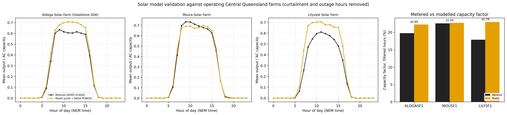

### Irradiance-bias sensitivity

Irradiance source: NASA POWER. Irradiance is scaled to test NASA POWER
bias; the least-cost design is re-selected at each level.

| IrradianceScale | MeanCapacityFactor | Selection | PvMW | BessPowerMW | BessEnergyMWh | TotalAnnualCostAUDm | AnnualScope2EmissionsKt |
| --- | --- | --- | --- | --- | --- | --- | --- |
| 0.850 | 0.257 | Least cost (any charging) | 200.000 | 50.000 | 100.000 | 220.156 | 877.580 |
| 0.850 | 0.257 | Least cost (no grid charging) | 400.000 | 50.000 | 200.000 | 230.954 | 698.216 |
| 0.900 | 0.272 | Least cost (any charging) | 200.000 | 50.000 | 100.000 | 218.436 | 860.042 |
| 0.900 | 0.272 | Least cost (no grid charging) | 400.000 | 50.000 | 200.000 | 229.675 | 691.417 |
| 0.950 | 0.287 | Least cost (any charging) | 200.000 | 50.000 | 100.000 | 216.719 | 842.734 |
| 0.950 | 0.287 | Least cost (no grid charging) | 300.000 | 50.000 | 200.000 | 220.388 | 723.479 |
| 1.000 | 0.301 | Least cost (any charging) | 200.000 | 50.000 | 100.000 | 215.033 | 826.146 |
| 1.000 | 0.301 | Least cost (no grid charging) | 300.000 | 50.000 | 200.000 | 219.000 | 714.805 |

Year-to-year capacity factor (min / mean / max over the weather years):

| Site | min | mean | max |
| --- | --- | --- | --- |
| Rockhampton | 0.263 | 0.272 | 0.282 |
| Gladstone | 0.265 | 0.270 | 0.276 |
| Livingstone (Yeppoon) | 0.265 | 0.273 | 0.283 |
| Karratha | 0.302 | 0.308 | 0.316 |
| Port Hedland | 0.300 | 0.306 | 0.314 |

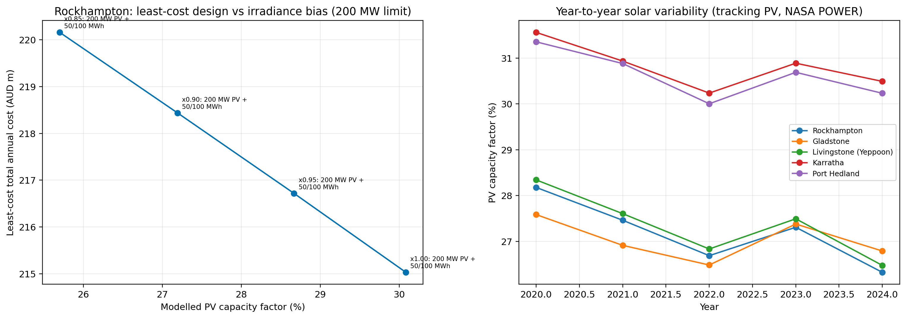

Ground-measured data placed in `inputs/solar_measured/<site_id>.csv` replaces
NASA POWER automatically.

## 8. Rule-based vs price-aware battery dispatch

| Design | Controller | AnnualEnergyCostAUDm | NetworkChargesAUDm | TotalAnnualCostAUDm | SavingVsRuleAUDm | CurtailedSolarMWh | EquivalentFullCycles | AnnualScope2EmissionsKt |
| --- | --- | --- | --- | --- | --- | --- | --- | --- |
| 200 MW PV + 0 MW/0 MWh | Rule-based | 164.53 | 19.09 | 213.15 | 0.00 | 107.81 | 0.00 | 859.74 |
| 200 MW PV + 0 MW/0 MWh | Price-aware LP (perfect foresight) | 161.39 | 20.42 | 211.33 | 1.82 | 498,148.53 | 0.00 | 926.48 |
| 200 MW PV + 0 MW/0 MWh | Price-aware, day-ahead forecast | 164.53 | 19.09 | 213.15 | 0.00 | 107.80 | 0.00 | 859.74 |
| 200 MW PV + 50 MW/100 MWh | Rule-based | 163.65 | 18.99 | 218.44 | 0.00 | 107.81 | 202.07 | 860.04 |
| 200 MW PV + 50 MW/100 MWh | Price-aware LP (perfect foresight) | 149.87 | 20.21 | 205.88 | 12.56 | 436,182.13 | 2,270.65 | 921.55 |
| 200 MW PV + 50 MW/100 MWh | Price-aware, day-ahead forecast | 156.80 | 19.05 | 211.64 | 6.79 | 6.95 | 2,050.93 | 862.77 |
| 200 MW PV + 50 MW/200 MWh | Rule-based | 163.65 | 18.99 | 221.36 | 0.00 | 107.81 | 101.04 | 860.05 |
| 200 MW PV + 50 MW/200 MWh | Price-aware LP (perfect foresight) | 145.22 | 20.12 | 204.06 | 17.30 | 387,839.98 | 1,795.29 | 917.03 |
| 200 MW PV + 50 MW/200 MWh | Price-aware, day-ahead forecast | 152.21 | 19.09 | 210.01 | 11.35 | 0.00 | 1,697.98 | 864.77 |
| 200 MW PV + 100 MW/200 MWh | Rule-based | 163.65 | 18.99 | 224.70 | 0.00 | 107.81 | 101.04 | 860.05 |
| 200 MW PV + 100 MW/200 MWh | Price-aware LP (perfect foresight) | 139.02 | 20.09 | 201.17 | 23.53 | 371,444.67 | 1,968.93 | 915.35 |
| 200 MW PV + 100 MW/200 MWh | Price-aware, day-ahead forecast | 149.35 | 19.09 | 210.50 | 14.20 | 0.00 | 1,797.57 | 865.06 |
| 200 MW PV + 100 MW/400 MWh | Rule-based | 163.65 | 18.99 | 230.56 | 0.00 | 107.81 | 50.52 | 860.06 |
| 200 MW PV + 100 MW/400 MWh | Price-aware LP (perfect foresight) | 130.02 | 19.91 | 197.85 | 32.71 | 275,403.62 | 1,646.66 | 906.42 |
| 200 MW PV + 100 MW/400 MWh | Price-aware, day-ahead forecast | 140.66 | 19.17 | 207.74 | 22.81 | 0.00 | 1,541.82 | 868.88 |
| 200 MW PV + 150 MW/600 MWh | Rule-based | 163.65 | 18.99 | 239.75 | 0.00 | 107.81 | 33.68 | 860.07 |
| 200 MW PV + 150 MW/600 MWh | Price-aware LP (perfect foresight) | 116.03 | 19.73 | 192.86 | 46.89 | 176,538.46 | 1,548.15 | 897.19 |
| 200 MW PV + 150 MW/600 MWh | Price-aware, day-ahead forecast | 130.17 | 19.24 | 206.52 | 33.23 | 0.00 | 1,413.09 | 872.30 |
| 300 MW PV + 0 MW/0 MWh | Rule-based | 153.24 | 16.63 | 214.16 | 0.00 | 272,261.01 | 0.00 | 736.44 |
| 300 MW PV + 0 MW/0 MWh | Price-aware LP (perfect foresight) | 149.14 | 18.40 | 211.83 | 2.33 | 934,121.84 | 0.00 | 825.13 |
| 300 MW PV + 0 MW/0 MWh | Price-aware, day-ahead forecast | 153.24 | 16.63 | 214.16 | 0.00 | 272,260.43 | 0.00 | 736.44 |
| 300 MW PV + 50 MW/100 MWh | Rule-based | 152.45 | 16.54 | 219.55 | 0.00 | 272,255.94 | 188.76 | 736.72 |
| 300 MW PV + 50 MW/100 MWh | Price-aware LP (perfect foresight) | 137.56 | 18.05 | 206.17 | 13.38 | 818,357.46 | 2,133.50 | 812.79 |
| 300 MW PV + 50 MW/100 MWh | Price-aware, day-ahead forecast | 145.17 | 16.37 | 212.09 | 7.45 | 188,924.07 | 1,902.66 | 728.10 |
| 300 MW PV + 50 MW/200 MWh | Rule-based | 152.45 | 16.54 | 222.47 | 0.00 | 272,255.94 | 94.38 | 736.73 |
| 300 MW PV + 50 MW/200 MWh | Price-aware LP (perfect foresight) | 132.62 | 17.85 | 203.95 | 18.52 | 729,427.01 | 1,759.29 | 802.93 |
| 300 MW PV + 50 MW/200 MWh | Price-aware, day-ahead forecast | 140.41 | 16.25 | 210.15 | 12.32 | 131,372.32 | 1,661.72 | 722.50 |
| 300 MW PV + 100 MW/200 MWh | Rule-based | 152.45 | 16.54 | 225.81 | 0.00 | 272,255.94 | 94.38 | 736.73 |
| 300 MW PV + 100 MW/200 MWh | Price-aware LP (perfect foresight) | 126.73 | 17.84 | 201.39 | 24.42 | 721,414.30 | 1,862.27 | 802.16 |
| 300 MW PV + 100 MW/200 MWh | Price-aware, day-ahead forecast | 137.32 | 16.27 | 210.42 | 15.39 | 136,672.45 | 1,720.99 | 723.38 |
| 300 MW PV + 100 MW/400 MWh | Rule-based | 152.45 | 16.54 | 231.67 | 0.00 | 272,255.94 | 47.19 | 736.74 |
| 300 MW PV + 100 MW/400 MWh | Price-aware LP (perfect foresight) | 117.39 | 17.54 | 197.60 | 34.06 | 576,866.86 | 1,628.04 | 786.94 |
| 300 MW PV + 100 MW/400 MWh | Price-aware, day-ahead forecast | 128.32 | 16.20 | 207.19 | 24.48 | 77,494.58 | 1,554.94 | 719.58 |
| 300 MW PV + 150 MW/600 MWh | Rule-based | 152.45 | 16.54 | 240.86 | 0.00 | 272,255.94 | 31.46 | 736.75 |
| 300 MW PV + 150 MW/600 MWh | Price-aware LP (perfect foresight) | 103.25 | 17.29 | 192.41 | 48.45 | 452,559.52 | 1,559.82 | 774.51 |
| 300 MW PV + 150 MW/600 MWh | Price-aware, day-ahead forecast | 117.03 | 16.22 | 205.12 | 35.74 | 57,992.32 | 1,480.15 | 720.92 |
| 400 MW PV + 0 MW/0 MWh | Rule-based | 146.94 | 15.78 | 221.77 | 0.00 | 1,146,593.15 | 0.00 | 693.83 |
| 400 MW PV + 0 MW/0 MWh | Price-aware LP (perfect foresight) | 142.73 | 17.61 | 219.39 | 2.38 | 1,830,778.24 | 0.00 | 785.52 |
| 400 MW PV + 0 MW/0 MWh | Price-aware, day-ahead forecast | 146.94 | 15.78 | 221.77 | 0.00 | 1,146,592.46 | 0.00 | 693.83 |
| 400 MW PV + 50 MW/100 MWh | Rule-based | 146.22 | 15.69 | 227.23 | 0.00 | 1,146,585.54 | 180.41 | 694.11 |
| 400 MW PV + 50 MW/100 MWh | Price-aware LP (perfect foresight) | 130.95 | 17.17 | 213.44 | 13.79 | 1,680,996.07 | 2,094.81 | 768.56 |
| 400 MW PV + 50 MW/100 MWh | Price-aware, day-ahead forecast | 138.44 | 15.40 | 219.16 | 8.07 | 1,018,593.88 | 1,875.26 | 679.47 |
| 400 MW PV + 50 MW/200 MWh | Rule-based | 146.22 | 15.69 | 230.16 | 0.00 | 1,146,585.54 | 90.20 | 694.11 |
| 400 MW PV + 50 MW/200 MWh | Price-aware LP (perfect foresight) | 125.55 | 16.84 | 210.63 | 19.52 | 1,540,114.40 | 1,768.19 | 751.82 |
| 400 MW PV + 50 MW/200 MWh | Price-aware, day-ahead forecast | 133.30 | 15.09 | 216.63 | 13.52 | 887,490.49 | 1,668.12 | 664.07 |
| 400 MW PV + 100 MW/200 MWh | Rule-based | 146.22 | 15.69 | 233.50 | 0.00 | 1,146,586.35 | 90.20 | 694.11 |
| 400 MW PV + 100 MW/200 MWh | Price-aware LP (perfect foresight) | 119.87 | 16.83 | 208.29 | 25.21 | 1,535,999.32 | 1,845.56 | 751.50 |
| 400 MW PV + 100 MW/200 MWh | Price-aware, day-ahead forecast | 130.08 | 15.09 | 216.77 | 16.73 | 887,450.79 | 1,720.24 | 664.22 |
| 400 MW PV + 100 MW/400 MWh | Rule-based | 146.22 | 15.69 | 239.35 | 0.00 | 1,146,579.83 | 45.10 | 694.12 |
| 400 MW PV + 100 MW/400 MWh | Price-aware LP (perfect foresight) | 109.61 | 16.22 | 203.27 | 36.09 | 1,274,104.61 | 1,650.04 | 720.73 |
| 400 MW PV + 100 MW/400 MWh | Price-aware, day-ahead forecast | 120.33 | 14.57 | 212.34 | 27.01 | 658,899.43 | 1,589.90 | 637.93 |
| 400 MW PV + 150 MW/600 MWh | Rule-based | 146.22 | 15.69 | 248.54 | 0.00 | 1,146,550.55 | 30.07 | 694.13 |
| 400 MW PV + 150 MW/600 MWh | Price-aware LP (perfect foresight) | 94.83 | 15.68 | 197.14 | 51.41 | 1,038,291.56 | 1,592.68 | 693.53 |
| 400 MW PV + 150 MW/600 MWh | Price-aware, day-ahead forecast | 108.21 | 14.22 | 209.06 | 39.48 | 494,918.49 | 1,541.83 | 620.25 |

Three controllers: rule-based peak shaving; a daily linear programme with
**perfect foresight** (an upper bound on price-aware savings); and a realistic
controller that plans each day on persistence forecasts (yesterday's prices
and PV) and keeps an energy reserve for import-limit duty. Savings come mainly
from avoiding extreme price spikes and from curtailing PV in negative-price
hours.

Least-cost design among the tested grid under each controller:

| Controller | Design | TotalAnnualCostAUDm | AnnualScope2EmissionsKt | HourlyMatchedEmissionsKt | CfeScore |
| --- | --- | --- | --- | --- | --- |
| Price-aware LP (perfect foresight) | 300 MW PV + 150 MW/600 MWh | 192.41 | 774.51 | 756.16 | 0.51 |
| Price-aware, day-ahead forecast | 300 MW PV + 150 MW/600 MWh | 205.12 | 720.92 | 715.40 | 0.53 |
| Rule-based | 200 MW PV + 50 MW/100 MWh | 218.44 | 860.04 | 857.62 | 0.43 |

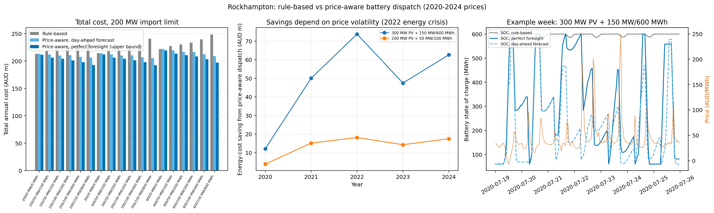

## 8a. Economic uncertainty (Monte Carlo)

| Statistic | Value |
| --- | --- |
| DeterministicLeastCostDesign | 200 MW PV + 50/100 MWh (grid chg) |
| DeterministicTotalAUDm | 218.43573648589722 |
| P10TotalAUDm | 117.66816148183867 |
| P50TotalAUDm | 216.70945318838224 |
| P90TotalAUDm | 383.8487482071021 |
| ShareWhereBaseDesignIsOptimal | 0.353 |
| MedianRegretOfBaseDesignAUDm | 1.2591322809911674 |
| P90RegretOfBaseDesignAUDm | 11.288436089949592 |

How often each design is the least-cost choice:

| Design | ShareOfSamplesOptimal |
| --- | --- |
| 100 MW PV + 50/200 MWh (grid chg) | 0.356 |
| 200 MW PV + 50/100 MWh (grid chg) | 0.353 |
| 300 MW PV + 50/100 MWh (grid chg) | 0.236 |
| 400 MW PV + 50/100 MWh (grid chg) | 0.055 |

Inputs ranked by influence on the base design's total cost:

| Parameter | Low | High | TotalAtLowAUDm | TotalAtHighAUDm | SwingAUDm |
| --- | --- | --- | --- | --- | --- |
| price_year | 2,020.0 | 2,022.0 | 111.7 | 363.0 | 251.3 |
| price_level_multiplier | 0.8 | 1.4 | 185.7 | 283.9 | 98.2 |
| discount_rate | 0.1 | 0.1 | 212.7 | 227.9 | 15.3 |
| pv_capex_multiplier | 0.8 | 1.2 | 213.2 | 225.0 | 11.8 |
| network_tariff_multiplier | 0.8 | 1.2 | 214.6 | 222.2 | 7.6 |
| irradiance_scale | 0.8 | 1.0 | 220.2 | 215.0 | 5.1 |
| bess_capex_multiplier | 0.7 | 1.3 | 216.6 | 220.3 | 3.8 |

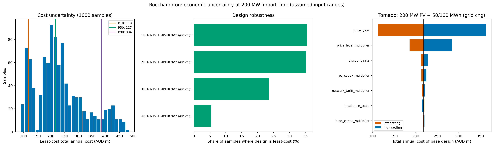

## 8a-1. Recent prices (2025-2026)

The base design was chosen on 2020-2024 prices. Re-running the design grid at
2025 prices (with 2025 weather) and 2026 prices to date (2025 weather):

| PriceWindow | Controller | Design | TotalAnnualCostAUDm | MeanPriceAUDperMWh | CostOfBaseDesignAUDm | RegretOfBaseDesignAUDm |
| --- | --- | --- | --- | --- | --- | --- |
| 2020-2024 prices (base) | Price-aware, day-ahead forecast | 300 MW PV + 150 MW/600 MWh | 205.12 | n/a | n/a | n/a |
| 2020-2024 prices (base) | Rule-based | 200 MW PV + 50 MW/100 MWh | 218.44 | n/a | n/a | n/a |
| 2025 prices | Price-aware, day-ahead forecast | 200 MW PV + 150 MW/600 MWh | 181.46 | 84.89 | 187.07 | 5.61 |
| 2025 prices | Rule-based | 200 MW PV + 50 MW/100 MWh | 193.13 | 84.89 | 193.13 | 0.00 |
| 2026 prices (to Nov 2026, 2025 weather) | Price-aware, day-ahead forecast | 200 MW PV + 50 MW/100 MWh | 153.82 | 67.42 | 168.60 | 14.78 |
| 2026 prices (to Nov 2026, 2025 weather) | Rule-based | 200 MW PV + 50 MW/100 MWh | 155.68 | 67.42 | 155.68 | 0.00 |

"Regret" is the extra annual cost of keeping the design chosen on 2020-2024
prices instead of re-optimising for the recent window.

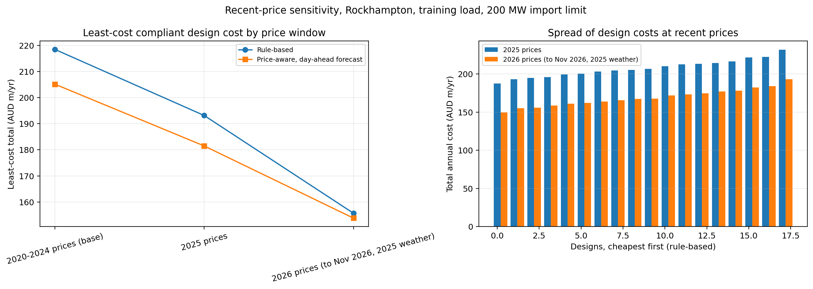

## 8a-2. The data centre as a flexible load

Pausing the flexible share of training (50% of IT) when the spot price
exceeds an assumed value of lost compute, or trimming load to hold the import
limit instead of using a battery. Totals include the value of lost compute
(assumption, swept):

| Case | LostComputeValuePerMWh | PvMW | BessPowerMW | HoursPausedPerYear | LostItGWhPerYear | LostComputeValueAUDm | TotalAnnualCostAUDm | SavingVsBaseDesignAUDm | MeetsImportLimit |
| --- | --- | --- | --- | --- | --- | --- | --- | --- | --- |
| Grid only (no flexibility) | 0.00 | 0.00 | 0.00 | 0.00 | 0.00 | 0.00 | 214.74 | 3.69 | False |
| Base design, no flexibility | 0.00 | 200.00 | 50.00 | 0.00 | 0.00 | 0.00 | 218.44 | 0.00 | True |
| Price response only | 300.00 | 0.00 | 0.00 | 378.40 | 32.79 | 9.84 | 194.12 | 24.31 | False |
| Import limit by curtailment (no battery) | 300.00 | 200.00 | 0.00 | 1,029.20 | 3.45 | 1.04 | 212.67 | 5.76 | True |
| Base design + price response | 300.00 | 200.00 | 50.00 | 378.40 | 32.79 | 9.84 | 199.03 | 19.40 | True |
| Price response only | 1,000.00 | 0.00 | 0.00 | 57.60 | 5.08 | 5.08 | 203.21 | 15.23 | False |
| Import limit by curtailment (no battery) | 1,000.00 | 200.00 | 0.00 | 1,029.20 | 3.45 | 3.45 | 215.09 | 3.35 | True |
| Base design + price response | 1,000.00 | 200.00 | 50.00 | 57.60 | 5.08 | 5.08 | 207.85 | 10.59 | True |
| Price response only | 3,000.00 | 0.00 | 0.00 | 13.40 | 1.19 | 3.56 | 209.01 | 9.43 | False |
| Import limit by curtailment (no battery) | 3,000.00 | 200.00 | 0.00 | 1,029.20 | 3.45 | 10.36 | 221.99 | -3.56 | True |
| Base design + price response | 3,000.00 | 200.00 | 50.00 | 13.40 | 1.19 | 3.56 | 213.26 | 5.18 | True |

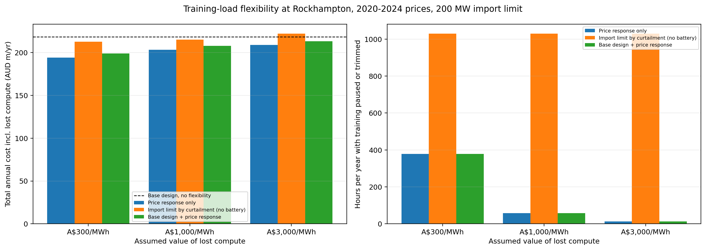

## 8a-3. Real GPU-cluster load profile

The synthetic IT profile compared with the hourly GPU allocation of a large
production cluster (Alibaba PAI GPU trace, 2020; tiled over 2020-2024):

| Profile | PeakFacilityMW | MeanFacilityMW | LoadFactor | P99HourlyRampMW | HoursPerYearAboveLimit | LargestContinuousExcessMWh | LeastCostDesign | LeastCostTotalAUDm |
| --- | --- | --- | --- | --- | --- | --- | --- | --- |
| Synthetic training | 243.15 | 200.70 | 0.83 | 7.50 | 4,031.00 | 406.54 | 200 MW PV + 50 MW/100 MWh | 218.44 |
| Synthetic mixed | 187.68 | 153.03 | 0.82 | 6.71 | 0.00 | 0.00 | 200 MW PV + 0 MW/0 MWh | 168.82 |
| Synthetic inference | 156.96 | 105.35 | 0.67 | 11.95 | 0.00 | 0.00 | 200 MW PV + 0 MW/0 MWh | 131.16 |
| Alibaba trace, as recorded | 197.14 | 117.00 | 0.59 | 34.15 | 0.00 | 0.00 | 200 MW PV + 0 MW/0 MWh | 124.89 |
| Alibaba trace, at training utilisation | 268.14 | 204.26 | 0.76 | 45.62 | 5,316.40 | 3,561.46 | none in design grid | n/a |

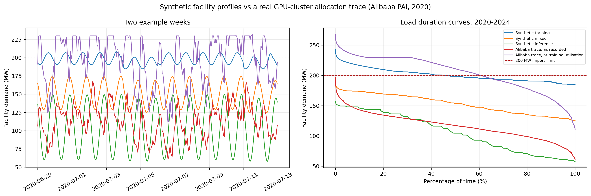

The trace has much larger hour-to-hour ramps than the synthetic profile. Run
at training-level utilisation, its peak reaches the full-IT, hot-weather
demand, which no battery in the design grid can cap at the import limit.

## 8b. Climate-change sensitivity

| Site | +0 C peak MW | +1 C peak MW | +2 C peak MW | +3 C peak MW |
| --- | --- | --- | --- | --- |
| Gladstone | 239.2 | 241.4 | 243.6 | 245.7 |
| Karratha | 238.6 | 240.7 | 242.9 | 245.0 |
| Livingstone (Yeppoon) | 237.0 | 239.1 | 241.3 | 243.5 |
| Port Hedland | 255.4 | 257.5 | 259.7 | 261.8 |
| Rockhampton | 243.2 | 245.3 | 247.5 | 249.6 |

| Site | +0 C water ML | +1 C water ML | +2 C water ML | +3 C water ML |
| --- | --- | --- | --- | --- |
| Gladstone | 1,928 | 2,177 | 2,415 | 2,634 |
| Karratha | 3,018 | 3,205 | 3,361 | 3,485 |
| Livingstone (Yeppoon) | 2,246 | 2,500 | 2,727 | 2,926 |
| Port Hedland | 2,916 | 3,056 | 3,188 | 3,313 |
| Rockhampton | 2,030 | 2,262 | 2,482 | 2,684 |

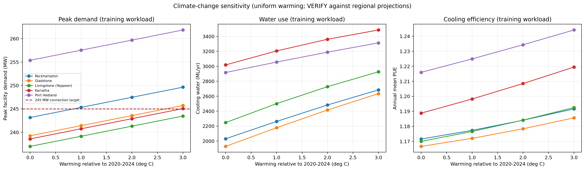

## 8c. Backup supply and reliability (assumed parameters - VERIFY)

| Site | UnitsNeededForPeak | SpareUnitsForTargetRisk | GensetUnits | InstalledBackupMW | BackupCapexAUDm | AnnualisedBackupCostAUDm | ProbabilityInsufficientWithNPlus1 | AnnualTestEmissionsKt |
| --- | --- | --- | --- | --- | --- | --- | --- | --- |
| Rockhampton | 82 | 5 | 87 | 261.000 | 287.100 | 28.551 | 0.202 | 2.207 |
| Gladstone | 80 | 5 | 85 | 255.000 | 280.500 | 27.895 | 0.194 | 2.156 |
| Livingstone (Yeppoon) | 79 | 5 | 84 | 252.000 | 277.200 | 27.567 | 0.191 | 2.131 |
| Karratha | 80 | 5 | 85 | 255.000 | 280.500 | 27.895 | 0.194 | 2.156 |
| Port Hedland | 86 | 5 | 91 | 273.000 | 300.300 | 29.864 | 0.216 | 2.308 |

With ~80 standby units, simple N+1 redundancy leaves a high chance that too
few units start; the spare-unit count above is sized for the configured
start-failure target.

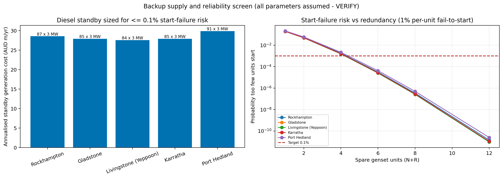

## 9. Staged growth and declining system strength

Minimum fault level each facility stage needs to pass the voltage, SCR and
trip-step criteria, compared with today's published minimum N-1 value:

| ConnectionPoint | StageMW | RequiredFaultKA | RequiredAsShareOfPublished | SystemStrengthHeadroomPercent |
| --- | --- | --- | --- | --- |
| Bouldercombe 275 kV | 100.00 | 2.54 | 0.30 | 70.47 |
| Bouldercombe 275 kV | 245.00 | 6.22 | 0.72 | 27.65 |
| Bouldercombe 275 kV | 500.00 | 12.70 | 1.48 | -47.66 |
| Bouldercombe 275 kV | 750.00 | 19.05 | 2.21 | -121.49 |
| Calliope River 275 kV | 100.00 | 2.54 | 0.29 | 70.81 |
| Calliope River 275 kV | 245.00 | 6.22 | 0.72 | 28.48 |
| Calliope River 275 kV | 500.00 | 12.70 | 1.46 | -45.96 |
| Calliope River 275 kV | 750.00 | 19.05 | 2.19 | -118.94 |
| Larcom Creek 275 kV | 100.00 | 2.54 | 0.77 | 23.04 |
| Larcom Creek 275 kV | 245.00 | 6.22 | 1.89 | -88.56 |
| Larcom Creek 275 kV | 500.00 | 12.70 | 3.85 | -284.81 |
| Larcom Creek 275 kV | 750.00 | 19.05 | 5.77 | -477.21 |

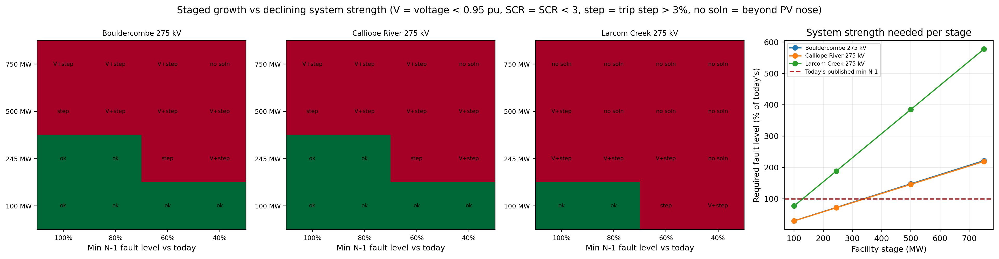

## 10. Training-load oscillation and flicker

| ConnectionPoint | LargestSwingPassingAtAllPeriods | WorstPst | WorstSwingMW | WorstPeriodS |
| --- | --- | --- | --- | --- |
| Bouldercombe 275 kV | 10% of IT | 1.83 | 115.00 | 0.33 |
| Calliope River 275 kV | 10% of IT | 1.81 | 115.00 | 0.33 |
| Larcom Creek 275 kV | 0% of IT | 6.56 | 115.00 | 0.33 |

Repetitive training-load swings are screened as rectangular voltage changes
against the Pst = 1 curve (digitised approximation - VERIFY) and HV-EHV
planning levels (NER S5.1.5 / AS/NZS 61000.3.7). Swing periods of 1-10 s fall in
the inter-area mode band and need small-signal study regardless. Large
repetitive swings would need on-site smoothing (UPS/BESS/supercapacitor) or
job-level power management.

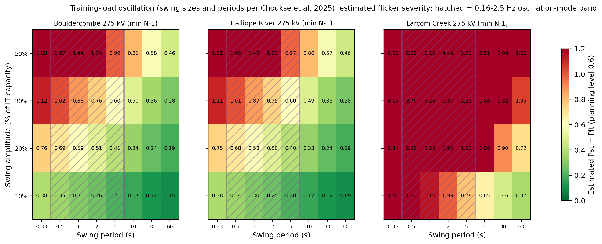

## 11. Reduced multi-bus Central Queensland model

Topology and route lengths from OpenStreetMap, circuit counts from the TAPR,
typical 275 kV impedances (VERIFY). Source impedances fitted to published
minimum system-normal fault levels, validated against the published minimum
N-1 levels it was not fitted to:

| Bus | Name | PublishedMinNormalMVA | ModelMinNormalMVA | FitErrorPercent | PublishedMinN1MVA | ModelMinN1MVA | N1ValidationErrorPercent |
| --- | --- | --- | --- | --- | --- | --- | --- |
| STAN | Stanwell | 5,144.2 | 4,961.1 | -3.6 | 4,286.8 | 4,697.7 | 9.6 |
| BOUL | Bouldercombe | 4,810.8 | 4,798.6 | -0.3 | 4,096.3 | 4,499.2 | 9.8 |
| RAGL | Raglan | 3,667.6 | 4,143.4 | 13.0 | 2,048.2 | 2,950.9 | 44.1 |
| LARC | Larcom Creek | 4,382.1 | 4,394.2 | 0.3 | 1,571.8 | 2,486.9 | 58.2 |
| CALR | Calliope River | 4,953.7 | 4,697.1 | -5.2 | 4,143.9 | 4,190.5 | 1.1 |
| GLPS | Gladstone PS | 4,715.5 | 4,693.4 | -0.5 | 4,001.0 | 4,188.7 | 4.7 |
| WURD | Wurdong | 4,477.4 | 4,324.6 | -3.4 | 3,048.4 | 2,787.3 | -8.6 |
| CALV | Calvale | 4,858.4 | 4,866.8 | 0.2 | 4,001.0 | 4,426.0 | 10.6 |
| BROD | Broadsound | 2,857.9 | 2,833.5 | -0.9 | 2,333.9 | 2,076.7 | -11.0 |
| NEBO | Nebo | 2,191.0 | 2,341.7 | 6.9 | 1,905.3 | 1,920.1 | 0.8 |
| LILY | Lilyvale | 1,667.1 | 1,535.3 | -7.9 | 1,238.4 | 1,282.1 | 3.5 |
| GING | Gin Gin | 2,905.5 | 2,994.7 | 3.1 | 2,048.2 | 2,515.0 | 22.8 |

Voltage-limited hosting with a system-wide 0.95 pu criterion and
topological line outages:

| Name | SingleBusTheveninIntactMW | IntactHostingMW | WorstN1HostingMW | WorstOutage | N1LimitingBus |
| --- | --- | --- | --- | --- | --- |
| Bouldercombe | 623 | 623 | 584 | BOUL_RAGL_1 | BOUL |
| Calliope River | 641 | 610 | 544 | CALV_WURD_1 | CALR |
| Larcom Creek | 567 | 571 | 324 | LARC_CALR_1 | LARC |
| Stanwell | n/a | 644 | 610 | STAN_CALV_1 | STAN |
| Gladstone PS | n/a | 609 | 544 | CALV_WURD_1 | GLPS |
| Wurdong | n/a | 562 | 363 | CALR_WURD_1 | WURD |
| Calvale | n/a | 631 | 575 | CALV_WURD_1 | CALV |
| Raglan | n/a | 538 | 384 | RAGL_LARC_1 | RAGL |

Simultaneous data centres:

| Case | IntactMinVoltagePu | WorstN1MinVoltagePu | WorstOutage | PassesN1 |
| --- | --- | --- | --- | --- |
| 245 MW at BOUL | 0.9831 | 0.9819 | LARC_CALR_1 | True |
| 245 MW at CALR | 0.9827 | 0.9804 | CALV_WURD_1 | True |
| 245 MW at both BOUL and CALR | 0.9666 | 0.9638 | CALV_WURD_1 | True |

Lines carrying the largest share of the added load (incremental, no background
flows; these are the elements the thermal data request to Powerlink should cover):

| Case | Line | IncrementalFlowMW | ShareOfAddedLoadPercent |
| --- | --- | --- | --- |
| 245 MW at BOUL | STAN_BOUL_1 | 76.6 | 31.3 |
| 245 MW at BOUL | STAN_BOUL_2 | 76.6 | 31.3 |
| 245 MW at both BOUL and CALR | STAN_BOUL_2 | 121.8 | 24.9 |
| 245 MW at both BOUL and CALR | STAN_BOUL_1 | 121.8 | 24.9 |
| 245 MW at CALR | CALV_WURD_1 | 54.9 | 22.4 |
| 245 MW at CALR | BOUL_RAGL_1 | 53.4 | 21.8 |
| 245 MW at CALR | RAGL_LARC_1 | 53.4 | 21.8 |
| 245 MW at CALR | LARC_CALR_1 | 53.4 | 21.8 |
| 245 MW at CALR | CALR_WURD_1 | -51.9 | 21.2 |
| 245 MW at BOUL | LARC_CALR_1 | -48.2 | 19.7 |
| 245 MW at BOUL | RAGL_LARC_1 | -48.2 | 19.7 |
| 245 MW at BOUL | BOUL_RAGL_1 | -48.1 | 19.6 |
| 245 MW at both BOUL and CALR | CALR_GLPS_2 | -83.1 | 17.0 |
| 245 MW at both BOUL and CALR | CALR_GLPS_1 | -83.1 | 17.0 |
| 245 MW at both BOUL and CALR | CALV_WURD_1 | 65.1 | 13.3 |

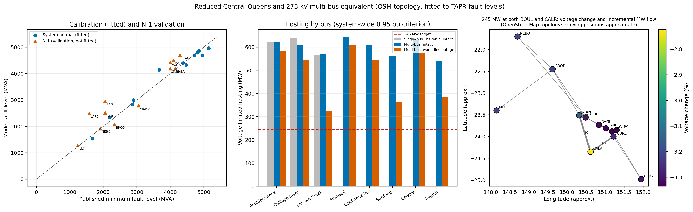

### Gladstone grid-section thermal proxy

Powerlink's TAPR 2025 names the Gladstone grid section as thermally limited
(54 constrained hours in 2024/25). Its 2024/25 transfer duration curve
(digitised from TAPR Figure 6.17, approximate) is shifted by each case's
incremental section flow from the multi-bus model:

| Case | IncrementalSectionFlowMW | EffectiveLimitMW | PeakSectionFlowMW | HoursPerYearAboveLimit | Interpretation |
| --- | --- | --- | --- | --- | --- |
| Existing (2024/25) | 0.0 | 1,188.4 | 1,300.0 | 56.9 | Reference |
| 245 MW at BOUL | -75.1 | 1,188.4 | 1,224.9 | 17.5 | Relieves the section |
| 245 MW at CALR | 149.5 | 1,188.4 | 1,449.5 | 328.3 | Adds constraint hours (re-dispatch or augmentation needed) |
| 245 MW at both BOUL and CALR | 74.4 | 1,188.4 | 1,374.4 | 162.0 | Adds constraint hours (re-dispatch or augmentation needed) |

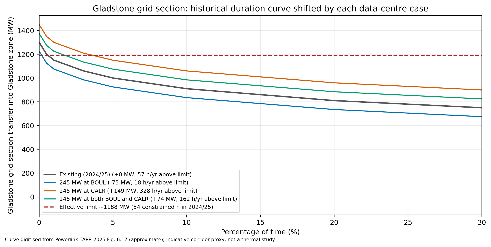

A data centre at Bouldercombe draws power out of the Gladstone zone and
relieves the constrained section; one at Calliope River adds to it. This is a
corridor-level indication, not a thermal study: line ratings, background flows
and N-1 load flows are still needed from Powerlink.

### Hourly power flow (one year of metered generation)

DC power flow for every hour of the most recent 365 days: AEMO-metered output of the
Central Queensland units at their buses, zone loads scaled with Queensland
demand, the external system as slack. Two load multipliers were fitted so the
modelled Gladstone and CQ-SQ section flows match Powerlink's published
2024/25 duration curves:

| LoadGroup | Buses | Multiplier | RmsErrorBeforeMW | RmsErrorAfterMW |
| --- | --- | --- | --- | --- |
| Gladstone zone loads | CALR WURD LARC | 0.57 | 414.36 | 176.99 |
| North Queensland transfer (Nebo) | NEBO | 0.30 | 414.36 | 176.99 |

| PercentOfTime | CQ-SQ published MW | Gladstone published MW | CQ-SQ model MW | Gladstone model MW |
| --- | --- | --- | --- | --- |
| 0 | 2,050 | 1,300 | 1,198 | 1,029 |
| 0 | n/a | 1,200 | n/a | 966 |
| 1 | 1,700 | 1,150 | 1,108 | 950 |
| 3 | 1,480 | 1,060 | 1,039 | 902 |
| 5 | 1,380 | 1,000 | 994 | 870 |
| 10 | 1,200 | 910 | 906 | 816 |
| 20 | 1,000 | 810 | 779 | 751 |
| 30 | 880 | 750 | 696 | 700 |
| 40 | 760 | 700 | 628 | 655 |
| 50 | 650 | 655 | 571 | 612 |
| 60 | 550 | 610 | 522 | 569 |
| 70 | 440 | 560 | 478 | 525 |
| 80 | 320 | 500 | 432 | 478 |
| 90 | 150 | 400 | 365 | 411 |
| 95 | 20 | 320 | 319 | 358 |
| 98 | -150 | 230 | 272 | 300 |
| 100 | -700 | 0 | -433 | 41 |

The model reproduces the middle of both curves but understates their spread
(generation elsewhere in Queensland is not modelled), so it is used for the
**change** each siting option causes, not for constraint hours.

| Case | MeanChangeMW | P99SectionFlowMW | HoursAboveEffectiveLimit |
| --- | --- | --- | --- |
| Existing system | -0.0 | 992.4 | 0 |
| 245 MW at Bouldercombe | -75.1 | 917.4 | 0 |
| 245 MW at Calliope River | 149.3 | 1,141.8 | 11 |
| 200 MW import at Bouldercombe (PV/BESS cap) | -61.3 | 931.2 | 0 |
| 200 MW import at Calliope River (PV/BESS cap) | 121.9 | 1,114.4 | 1 |

Circuits whose worst single-outage loading rises most (assumed 900 MVA rating per
circuit; VERIFY):

| Case | Circuit | MeanChangeMW | MaxN1LoadingPercent | ChangeInMaxN1LoadingPoints | HoursN1AboveRating |
| --- | --- | --- | --- | --- | --- |
| 245 MW at Bouldercombe | STAN_BOUL_1 | 76.6 | 126.7 | 15.8 | 1171 |
| 245 MW at Bouldercombe | STAN_BOUL_2 | 76.6 | 126.7 | 15.8 | 1171 |
| 245 MW at Calliope River | CALR_GLPS_1 | -46.6 | 134.3 | 10.3 | 569 |
| 245 MW at Calliope River | CALR_GLPS_2 | -46.6 | 134.3 | 10.3 | 569 |
| 245 MW at Calliope River | STAN_BOUL_2 | 45.2 | 120.2 | 9.3 | 337 |
| 245 MW at Calliope River | STAN_BOUL_1 | 45.2 | 120.2 | 9.3 | 337 |
| 245 MW at Calliope River | LARC_CALR_1 | 53.4 | 74.4 | 8.6 | 0 |
| 245 MW at Bouldercombe | CALR_GLPS_1 | -36.5 | 132.1 | 8.1 | 496 |
| 245 MW at Bouldercombe | CALR_GLPS_2 | -36.5 | 132.1 | 8.1 | 496 |
| 245 MW at Bouldercombe | STAN_CALV_1 | -35.9 | 58.9 | 4.4 | 0 |

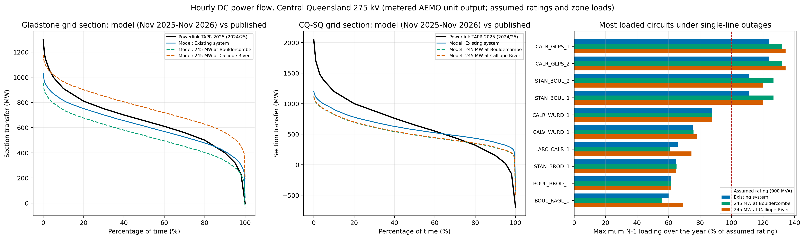

A Bouldercombe connection relieves the Gladstone section but loads the
Stanwell-Bouldercombe circuits; a Calliope River connection does the opposite.
The ratings of both groups are the key items of the Powerlink data request.

## 12. Open-source RMS dynamic study (ANDES)

Synchronous-machine (GENROU), governor (TGOV1) and exciter (SEXS) models on the
reduced Central Queensland network, with typical parameters; the minimum
condition is set near AEMO's Queensland secure inertia level and treated as
islanded; the maximum condition is interconnected to the NEM.

| Condition | DataCentreBus | Event | FrequencyNadirHz | FrequencyZenithHz | RoCoF500msHzPerS | MaxVoltageStepPercent | VoltageRecoveryTimeS | Outcome |
| --- | --- | --- | --- | --- | --- | --- | --- | --- |
| Minimum (low inertia, Queensland islanded) | BOUL | Sudden facility load loss | 50.000 | 50.489 | 0.454 | 1.096 | 0.000 | Passes |
| Minimum (low inertia, Queensland islanded) | BOUL | Sudden full load pickup | 49.512 | 50.000 | -0.453 | 1.137 | 0.000 | Passes |
| Minimum (low inertia, Queensland islanded) | BOUL | Repetitive training swing (30% IT, 2 s) | 49.950 | 50.108 | 0.128 | 0.324 | 0.000 | Passes |
| Minimum (low inertia, Queensland islanded) | BOUL | On-site PV trip (200 MW) | 49.601 | 50.000 | -0.370 | 0.672 | 0.000 | Passes |
| Minimum (low inertia, Queensland islanded) | BOUL | BESS trip (50 MW) | 49.900 | 50.000 | -0.093 | 0.162 | 0.000 | Passes |
| Minimum (low inertia, Queensland islanded) | BOUL | Adjacent 275 kV circuit outage | 49.999 | 50.000 | 0.000 | 0.257 | 0.000 | Passes |
| Minimum (low inertia, Queensland islanded) | CALR | Sudden facility load loss | 50.000 | 50.488 | 0.448 | 0.918 | 0.000 | Passes |
| Minimum (low inertia, Queensland islanded) | CALR | Sudden full load pickup | 49.512 | 50.000 | -0.447 | 0.934 | 0.000 | Passes |
| Minimum (low inertia, Queensland islanded) | CALR | Repetitive training swing (30% IT, 2 s) | 49.950 | 50.108 | 0.126 | 0.281 | 0.000 | Passes |
| Minimum (low inertia, Queensland islanded) | CALR | On-site PV trip (200 MW) | 49.601 | 50.000 | -0.365 | 0.592 | 0.000 | Passes |
| Minimum (low inertia, Queensland islanded) | CALR | BESS trip (50 MW) | 49.900 | 50.000 | -0.091 | 0.146 | 0.000 | Passes |
| Minimum (low inertia, Queensland islanded) | CALR | Adjacent 275 kV circuit outage | 49.991 | 50.003 | 0.006 | 1.132 | 0.400 | Passes |
| Maximum (high inertia, NEM interconnected) | BOUL | Sudden facility load loss | 50.000 | 50.069 | 0.052 | 0.507 | 0.000 | Passes |
| Maximum (high inertia, NEM interconnected) | BOUL | Sudden full load pickup | 49.931 | 50.000 | -0.052 | 0.510 | 0.000 | Passes |
| Maximum (high inertia, NEM interconnected) | BOUL | Repetitive training swing (30% IT, 2 s) | 49.993 | 50.014 | 0.015 | 0.146 | 0.000 | Passes |
| Maximum (high inertia, NEM interconnected) | BOUL | On-site PV trip (200 MW) | 49.944 | 50.000 | -0.043 | 0.152 | 0.000 | Passes |
| Maximum (high inertia, NEM interconnected) | BOUL | BESS trip (50 MW) | 49.986 | 50.000 | -0.011 | 0.040 | 0.000 | Passes |
| Maximum (high inertia, NEM interconnected) | BOUL | Adjacent 275 kV circuit outage | 49.998 | 50.001 | -0.001 | 0.399 | 0.000 | Passes |
| Maximum (high inertia, NEM interconnected) | CALR | Sudden facility load loss | 50.000 | 50.069 | 0.054 | 0.385 | 0.000 | Passes |
| Maximum (high inertia, NEM interconnected) | CALR | Sudden full load pickup | 49.931 | 50.000 | -0.054 | 0.388 | 0.000 | Passes |
| Maximum (high inertia, NEM interconnected) | CALR | Repetitive training swing (30% IT, 2 s) | 49.993 | 50.014 | 0.015 | 0.110 | 0.000 | Passes |
| Maximum (high inertia, NEM interconnected) | CALR | On-site PV trip (200 MW) | 49.944 | 50.000 | -0.045 | 0.122 | 0.000 | Passes |
| Maximum (high inertia, NEM interconnected) | CALR | BESS trip (50 MW) | 49.986 | 50.000 | -0.011 | 0.031 | 0.000 | Passes |
| Maximum (high inertia, NEM interconnected) | CALR | Adjacent 275 kV circuit outage | 49.982 | 50.011 | -0.026 | 2.337 | 0.700 | Passes |

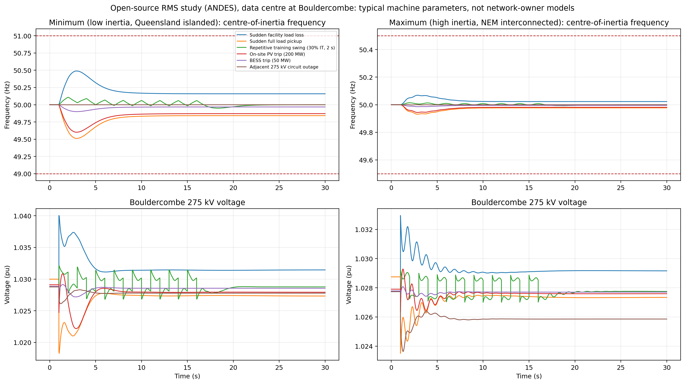

The RMS results are less severe than the reduced-order screen below (for
example an islanded full-load loss peaks near 50.5 Hz rather than 51 Hz),
because every machine carries its own governor response. Both rely on assumed
governor settings and neither replaces a PowerFactory/PSS/E study with
network-owner models.

### Frequency-response sensitivity (islanded Queensland)

Minimum delivered governor response (share of the modelled response, and the
equivalent MW/Hz) that keeps the islanded full-load loss and pickup inside
49.0-51.0 Hz:

| Event | InertiaMWs | GovernorT1s | MinimumResponseShare | MinimumEquivalentPfrMWperHz | Note |
| --- | --- | --- | --- | --- | --- |
| Sudden facility load loss | 12000 | 0.500 | 0.375 | 585.137 | interpolated |
| Sudden facility load loss | 12000 | 2.000 | 0.680 | 1,061.498 | interpolated |
| Sudden facility load loss | 12000 | 6.000 | n/a | n/a | fails at every tested share |
| Sudden facility load loss | 13000 | 0.500 | 0.364 | 568.302 | interpolated |
| Sudden facility load loss | 13000 | 2.000 | 0.641 | 1,000.382 | interpolated |
| Sudden facility load loss | 13000 | 6.000 | n/a | n/a | fails at every tested share |
| Sudden full load pickup | 12000 | 0.500 | 0.374 | 583.833 | interpolated |
| Sudden full load pickup | 12000 | 2.000 | 0.679 | 1,058.589 | interpolated |
| Sudden full load pickup | 12000 | 6.000 | n/a | n/a | fails at every tested share |
| Sudden full load pickup | 13000 | 0.500 | 0.363 | 566.960 | interpolated |
| Sudden full load pickup | 13000 | 2.000 | 0.639 | 997.368 | interpolated |
| Sudden full load pickup | 13000 | 6.000 | n/a | n/a | fails at every tested share |

The disagreement between the RMS model and the reduced-order screen is
explained by governor speed: with fast valves the event passes with about 40%
of the modelled response, but with the 6 s response assumed in the
reduced-order screen it fails at any response level.

### Fault ride-through

Near-bolted three-phase fault at each bus, cleared in 100 ms. If the data-centre
bus voltage falls below 0.7 pu (assumed facility trip setting), the whole
facility is disconnected during the fault:

| Condition | DataCentreBus | FaultBusesTested | FaultsThatTripFacility | WorstZenithHz | WorstNadirHz |
| --- | --- | --- | --- | --- | --- |
| Maximum (high inertia, NEM interconnected) | BOUL | 12 | 6 | 50.076 | 49.971 |
| Maximum (high inertia, NEM interconnected) | CALR | 12 | 5 | 50.076 | 49.965 |
| Minimum (low inertia, Queensland islanded) | BOUL | 12 | 11 | 50.494 | 49.917 |
| Minimum (low inertia, Queensland islanded) | CALR | 12 | 9 | 50.498 | 49.843 |

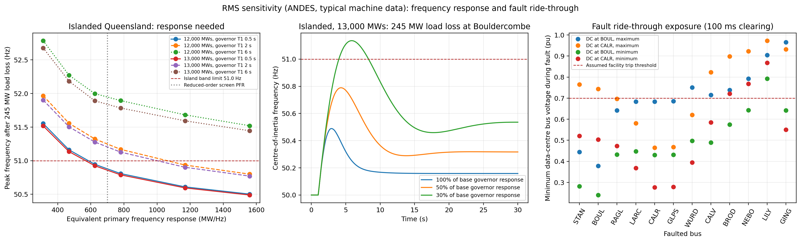

## 12a. Dynamic event screening (reduced-order)

Minimum condition = published minimum N-1 fault level and low system inertia;
maximum condition = published maximum fault level and high inertia. Events:
sudden load loss and pickup, training-load swing, PV trip, BESS trip and
network outage. Voltage recovery assumes a 20 s control time
constant. Frequency criteria: NEM mainland Frequency Operating Standard
(containment 49.5-50.5 Hz). Queensland-islanded inertia is AEMO's
minimum threshold (2024 Inertia Report); NEM and NWIS inertia and all
frequency-response values are assumptions. The event size relative to the
largest credible contingency and the minimum requirements below are the
robust outputs.

### Voltage

| ConnectionPoint | Condition | Event | PreEventVoltagePu | VoltageStepPercent | RecoveryTimeToBandS | Outcome |
| --- | --- | --- | --- | --- | --- | --- |
| Bouldercombe 275 kV | Minimum | Sudden facility load loss | 0.98 | 2.06 | 14.45 | Passes |
| Bouldercombe 275 kV | Minimum | Sudden full load pickup | 1.00 | -2.02 | 14.04 | Passes |
| Bouldercombe 275 kV | Minimum | Training-load swing pickup | 0.99 | -0.62 | 0.00 | Passes |
| Bouldercombe 275 kV | Minimum | On-site PV trip (import rises) | 1.00 | -1.69 | 10.44 | Passes |
| Bouldercombe 275 kV | Minimum | BESS trip while discharging | 0.98 | -0.46 | 0.00 | Passes |
| Bouldercombe 275 kV | Maximum | Sudden facility load loss | 0.99 | 0.74 | 0.00 | Passes |
| Bouldercombe 275 kV | Maximum | Sudden full load pickup | 1.00 | -0.74 | 0.00 | Passes |
| Bouldercombe 275 kV | Maximum | Training-load swing pickup | 0.99 | -0.22 | 0.00 | Passes |
| Bouldercombe 275 kV | Maximum | On-site PV trip (import rises) | 1.00 | -0.61 | 0.00 | Passes |
| Bouldercombe 275 kV | Maximum | BESS trip while discharging | 0.99 | -0.16 | 0.00 | Passes |
| Bouldercombe 275 kV | Minimum | Network outage (intact to N-1) | 0.98 | -0.33 | 0.00 | Passes |
| Calliope River 275 kV | Minimum | Sudden facility load loss | 0.98 | 2.03 | 14.19 | Passes |
| Calliope River 275 kV | Minimum | Sudden full load pickup | 1.00 | -1.99 | 13.78 | Passes |
| Calliope River 275 kV | Minimum | Training-load swing pickup | 0.99 | -0.61 | 0.00 | Passes |
| Calliope River 275 kV | Minimum | On-site PV trip (import rises) | 1.00 | -1.66 | 10.18 | Passes |
| Calliope River 275 kV | Minimum | BESS trip while discharging | 0.98 | -0.45 | 0.00 | Passes |
| Calliope River 275 kV | Maximum | Sudden facility load loss | 0.99 | 0.74 | 0.00 | Passes |
| Calliope River 275 kV | Maximum | Sudden full load pickup | 1.00 | -0.73 | 0.00 | Passes |
| Calliope River 275 kV | Maximum | Training-load swing pickup | 0.99 | -0.21 | 0.00 | Passes |
| Calliope River 275 kV | Maximum | On-site PV trip (import rises) | 1.00 | -0.60 | 0.00 | Passes |
| Calliope River 275 kV | Maximum | BESS trip while discharging | 0.99 | -0.16 | 0.00 | Passes |
| Calliope River 275 kV | Minimum | Network outage (intact to N-1) | 0.98 | -0.36 | 0.00 | Passes |
| Larcom Creek 275 kV | Minimum | Sudden facility load loss | 0.94 | 6.77 | 38.26 | Pre-event voltage already below 0.95 pu |
| Larcom Creek 275 kV | Minimum | Sudden full load pickup | 1.00 | -6.34 | 36.95 | Voltage step exceeds 3% screening limit |
| Larcom Creek 275 kV | Minimum | Training-load swing pickup | 0.96 | -2.26 | 16.34 | Passes |
| Larcom Creek 275 kV | Minimum | On-site PV trip (import rises) | 0.99 | -5.48 | 34.03 | Voltage step exceeds 3% screening limit |
| Larcom Creek 275 kV | Minimum | BESS trip while discharging | 0.95 | -1.69 | 10.46 | Passes |
| Larcom Creek 275 kV | Maximum | Sudden facility load loss | 0.99 | 0.99 | 0.00 | Passes |
| Larcom Creek 275 kV | Maximum | Sudden full load pickup | 1.00 | -0.98 | 0.00 | Passes |
| Larcom Creek 275 kV | Maximum | Training-load swing pickup | 0.99 | -0.29 | 0.00 | Passes |
| Larcom Creek 275 kV | Maximum | On-site PV trip (import rises) | 1.00 | -0.81 | 0.00 | Passes |
| Larcom Creek 275 kV | Maximum | BESS trip while discharging | 0.99 | -0.21 | 0.00 | Passes |
| Larcom Creek 275 kV | Minimum | Network outage (intact to N-1) | 0.98 | -4.56 | 30.33 | Voltage step exceeds 3% screening limit |
| Pegs Creek 132 kV (Karratha ring) | Minimum | Sudden facility load loss | n/a | n/a | n/a | No power-flow solution (load beyond PV-curve nose) |
| Pegs Creek 132 kV (Karratha ring) | Minimum | Sudden full load pickup | 0.95 | n/a | n/a | No power-flow solution (load beyond PV-curve nose) |
| Pegs Creek 132 kV (Karratha ring) | Minimum | Training-load swing pickup | n/a | n/a | n/a | No power-flow solution (load beyond PV-curve nose) |
| Pegs Creek 132 kV (Karratha ring) | Minimum | On-site PV trip (import rises) | 0.91 | n/a | n/a | No power-flow solution (load beyond PV-curve nose) |
| Pegs Creek 132 kV (Karratha ring) | Minimum | BESS trip while discharging | n/a | n/a | n/a | No power-flow solution (load beyond PV-curve nose) |
| Pegs Creek 132 kV (Karratha ring) | Maximum | Sudden facility load loss | 0.96 | 3.20 | 23.25 | Voltage step exceeds 3% screening limit |
| Pegs Creek 132 kV (Karratha ring) | Maximum | Sudden full load pickup | 0.99 | -3.10 | 22.62 | Voltage step exceeds 3% screening limit |
| Pegs Creek 132 kV (Karratha ring) | Maximum | Training-load swing pickup | 0.97 | -0.96 | 0.00 | Passes |
| Pegs Creek 132 kV (Karratha ring) | Maximum | On-site PV trip (import rises) | 0.99 | -2.59 | 19.03 | Passes |
| Pegs Creek 132 kV (Karratha ring) | Maximum | BESS trip while discharging | 0.97 | -0.70 | 0.00 | Passes |
| Pegs Creek 132 kV (Karratha ring) | Minimum | Network outage (intact to N-1) | n/a | n/a | n/a | No power-flow solution (load beyond PV-curve nose) |
| Wedgefield 22 kV | Minimum | Sudden facility load loss | n/a | n/a | n/a | No power-flow solution (load beyond PV-curve nose) |
| Wedgefield 22 kV | Minimum | Sudden full load pickup | 1.00 | n/a | n/a | No power-flow solution (load beyond PV-curve nose) |
| Wedgefield 22 kV | Minimum | Training-load swing pickup | n/a | n/a | n/a | No power-flow solution (load beyond PV-curve nose) |
| Wedgefield 22 kV | Minimum | On-site PV trip (import rises) | 0.88 | n/a | n/a | No power-flow solution (load beyond PV-curve nose) |
| Wedgefield 22 kV | Minimum | BESS trip while discharging | n/a | n/a | n/a | No power-flow solution (load beyond PV-curve nose) |
| Wedgefield 22 kV | Maximum | Sudden facility load loss | n/a | n/a | n/a | No power-flow solution (load beyond PV-curve nose) |
| Wedgefield 22 kV | Maximum | Sudden full load pickup | 1.00 | n/a | n/a | No power-flow solution (load beyond PV-curve nose) |
| Wedgefield 22 kV | Maximum | Training-load swing pickup | n/a | n/a | n/a | No power-flow solution (load beyond PV-curve nose) |
| Wedgefield 22 kV | Maximum | On-site PV trip (import rises) | 0.88 | n/a | n/a | No power-flow solution (load beyond PV-curve nose) |
| Wedgefield 22 kV | Maximum | BESS trip while discharging | n/a | n/a | n/a | No power-flow solution (load beyond PV-curve nose) |

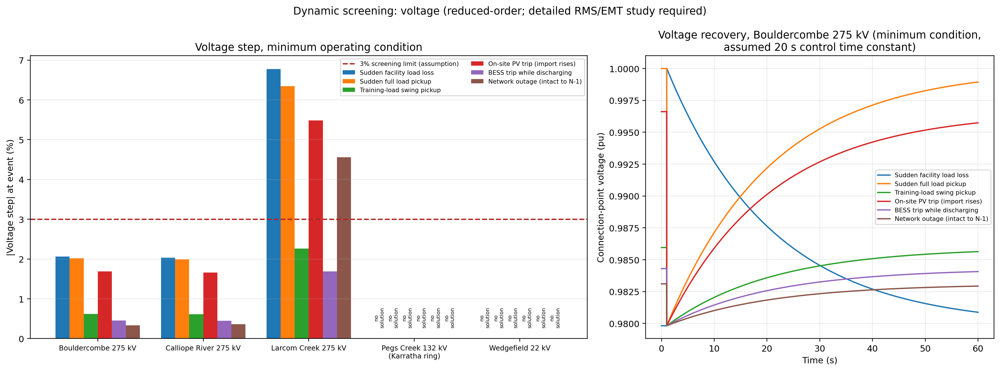

### Frequency

| Grid | Condition | Event | GridImportChangeMW | EventShareOfLargestContingency | NadirHz | ZenithHz | RoCoF500msHzPerS | Outcome |
| --- | --- | --- | --- | --- | --- | --- | --- | --- |
| NEM | Minimum | Sudden facility load loss | -245.000 | 0.327 | 50.000 | 50.254 | 0.119 | Passes |
| NEM | Minimum | Sudden full load pickup | 245.000 | 0.327 | 49.746 | 50.000 | -0.119 | Passes |
| NEM | Minimum | Training-load swing pickup | 69.000 | 0.092 | 49.920 | 50.000 | -0.034 | Passes |
| NEM | Minimum | On-site PV trip (import rises) | 200.000 | 0.267 | 49.790 | 50.000 | -0.097 | Passes |
| NEM | Minimum | BESS trip while discharging | 50.000 | 0.067 | 49.939 | 50.000 | -0.024 | Passes |
| NEM | Maximum | Sudden facility load loss | -245.000 | 0.327 | 50.000 | 50.122 | 0.050 | Passes |
| NEM | Maximum | Sudden full load pickup | 245.000 | 0.327 | 49.878 | 50.000 | -0.050 | Passes |
| NEM | Maximum | Training-load swing pickup | 69.000 | 0.092 | 49.957 | 50.000 | -0.014 | Passes |
| NEM | Maximum | On-site PV trip (import rises) | 200.000 | 0.267 | 49.899 | 50.000 | -0.041 | Passes |
| NEM | Maximum | BESS trip while discharging | 50.000 | 0.067 | 49.966 | 50.000 | -0.010 | Passes |
| NWIS | Minimum | Sudden facility load loss | -245.000 | 3.267 | n/a | n/a | 7.470 | Outside linear-model validity: under/over-frequency protection (load shedding, generator trips) would operate - system cannot absorb this event |
| NWIS | Minimum | Sudden full load pickup | 245.000 | 3.267 | n/a | n/a | -7.470 | Outside linear-model validity: under/over-frequency protection (load shedding, generator trips) would operate - system cannot absorb this event |
| NWIS | Minimum | Training-load swing pickup | 69.000 | 0.920 | n/a | n/a | -2.094 | Outside linear-model validity: under/over-frequency protection (load shedding, generator trips) would operate - system cannot absorb this event |
| NWIS | Minimum | On-site PV trip (import rises) | 200.000 | 2.667 | n/a | n/a | -6.091 | Outside linear-model validity: under/over-frequency protection (load shedding, generator trips) would operate - system cannot absorb this event |
| NWIS | Minimum | BESS trip while discharging | 50.000 | 0.667 | n/a | n/a | -1.518 | Outside linear-model validity: under/over-frequency protection (load shedding, generator trips) would operate - system cannot absorb this event |
| NWIS | Maximum | Sudden facility load loss | -245.000 | 3.267 | n/a | n/a | 2.974 | Outside linear-model validity: under/over-frequency protection (load shedding, generator trips) would operate - system cannot absorb this event |
| NWIS | Maximum | Sudden full load pickup | 245.000 | 3.267 | n/a | n/a | -2.974 | Outside linear-model validity: under/over-frequency protection (load shedding, generator trips) would operate - system cannot absorb this event |
| NWIS | Maximum | Training-load swing pickup | 69.000 | 0.920 | 47.992 | 50.000 | -0.837 | Leaves containment band |
| NWIS | Maximum | On-site PV trip (import rises) | 200.000 | 2.667 | n/a | n/a | -2.426 | Outside linear-model validity: under/over-frequency protection (load shedding, generator trips) would operate - system cannot absorb this event |
| NWIS | Maximum | BESS trip while discharging | 50.000 | 0.667 | 48.800 | 50.000 | -0.607 | Leaves containment band |
| QLD_islanded | Minimum | Sudden facility load loss | -245.000 | 0.327 | 50.000 | 51.064 | 0.489 | Leaves containment band |
| QLD_islanded | Minimum | Sudden full load pickup | 245.000 | 0.327 | 48.936 | 50.000 | -0.489 | Leaves containment band |
| QLD_islanded | Minimum | Training-load swing pickup | 69.000 | 0.092 | 49.737 | 50.000 | -0.138 | Passes |
| QLD_islanded | Minimum | On-site PV trip (import rises) | 200.000 | 0.267 | 49.203 | 50.000 | -0.399 | Passes |
| QLD_islanded | Minimum | BESS trip while discharging | 50.000 | 0.067 | 49.806 | 50.000 | -0.100 | Passes |
| QLD_islanded | Maximum | Sudden facility load loss | -245.000 | 0.327 | 50.000 | 50.410 | 0.197 | Passes |
| QLD_islanded | Maximum | Sudden full load pickup | 245.000 | 0.327 | 49.590 | 50.000 | -0.197 | Passes |
| QLD_islanded | Maximum | Training-load swing pickup | 69.000 | 0.092 | 49.877 | 50.000 | -0.056 | Passes |
| QLD_islanded | Maximum | On-site PV trip (import rises) | 200.000 | 0.267 | 49.663 | 50.000 | -0.161 | Passes |
| QLD_islanded | Maximum | BESS trip while discharging | 50.000 | 0.067 | 49.907 | 50.000 | -0.040 | Passes |

### Minimum system capability each event needs

| Grid | Event | MinimumInertiaForRoCoFMWs | MinimumPfrForContainmentMWperHz |
| --- | --- | --- | --- |
| NEM | Sudden facility load loss | 6,125 | 289 |
| NEM | Sudden full load pickup | 6,125 | 289 |
| NEM | Training-load swing pickup | 1,725 | 0 |
| NEM | On-site PV trip (import rises) | 5,000 | 196 |
| NEM | BESS trip while discharging | 1,250 | 0 |
| NWIS | Sudden facility load loss | 6,125 | 503 |
| NWIS | Sudden full load pickup | 6,125 | 503 |
| NWIS | Training-load swing pickup | 1,725 | 140 |
| NWIS | On-site PV trip (import rises) | 5,000 | 410 |
| NWIS | BESS trip while discharging | 1,250 | 101 |
| QLD_islanded | Sudden facility load loss | 6,125 | 180 |
| QLD_islanded | Sudden full load pickup | 6,125 | 180 |
| QLD_islanded | Training-load swing pickup | 1,725 | 2 |
| QLD_islanded | On-site PV trip (import rises) | 5,000 | 135 |
| QLD_islanded | BESS trip while discharging | 1,250 | 0 |

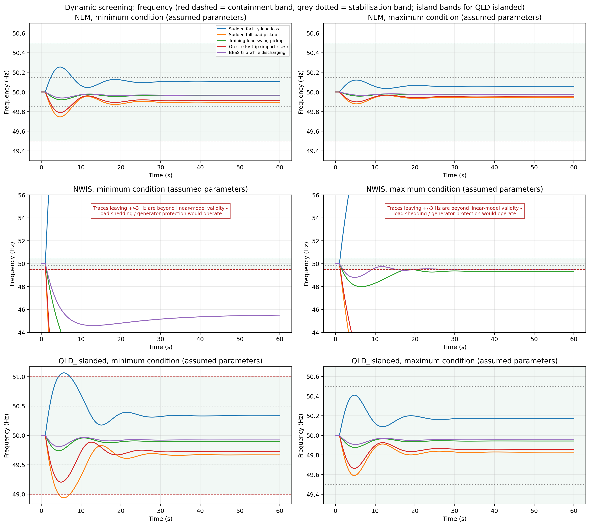

This screening identifies which events and conditions need detailed RMS/EMT
study (PowerFactory or PSS/E with network-owner models); it does not replace it.

## 13. Model validation

58 checks; all pass: True. Maximum
Thevenin voltage difference 6.63e-05 pu.

## Limitations

Firm capacity requires network-owner impedances, line and transformer
ratings, existing flows, N-1 load-flow results, control settings and approved
outage cases; thermal headroom cannot be estimated from fault level alone. Large-load dynamic
behaviour (fault ride-through, sub-second training-load oscillation) needs
EMT/RMS studies. The NWIS is an isolated system where frequency stability and
generation adequacy, not modelled here, may dominate.
